# Hop Envíos para Magento — Guía de uso

Guía para quien opera la tienda desde el panel de administración de Magento: cómo
configurar el método de envío Hop, qué ve el cliente en el checkout, cómo se despachan
los pedidos y cómo se manejan las etiquetas y los estados.

No hace falta conocimiento técnico para seguirla. La instalación y la conexión con Hop
están en la [Guía de instalación](instalacion.md).

Guías relacionadas:

- [Envíos multibulto](multibulto-guia-admin.md): las cuatro formas de despachar un pedido,
  los envíos en varios bultos y qué hacer cuando un despacho falla.
- [Configuración para Perú (Ubigeo)](peru-ubigeo.md): solo si la tienda vende a Perú.

---

## Qué hace el módulo

| Área | Funcionalidad |
|---|---|
| **Precios** | Envío gratis a partir de un importe · ajuste de la tarifa por porcentaje · suma o resta de un monto fijo · peso máximo por pedido |
| **Medidas** | Atributos de alto, ancho y largo propios o de la tienda · tamaño de categoría como respaldo |
| **Checkout** | Cotización en vivo · puntos de retiro en mapa y en listado · aviso si el cliente no elige punto |
| **Pedidos** | Punto Hop asignado al pedido · cambio de punto antes de despachar · despacho manual o automático por estado · seguimiento en la web de Hop |
| **Etiquetas** | JPEG (en PDF) o ZPL · tres tamaños · descarga individual o masiva |
| **Estados** | Hop avisa a Magento las novedades del envío y el pedido cambia de estado solo |

---

## 1. Método de envío

**Envíos Hop → Métodos de envío.**

### 1.1 Textos del checkout

- **Habilitado**: activa o desactiva Hop en el checkout.
- **Título**: el nombre del método que ve el cliente.
- **Descripción**: el texto que acompaña al método antes de que el cliente elija un punto
  de retiro.

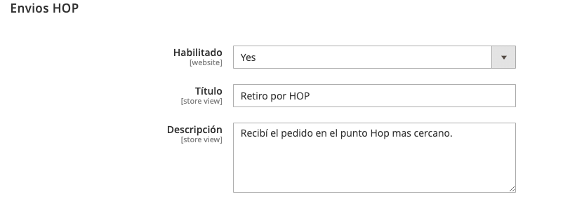

### 1.2 Precio del envío

El precio parte de la cotización que devuelve Hop y se puede ajustar:

| Campo | Qué hace | Ejemplo |
|---|---|---|
| **Ofrecer los puntos Hop sin cargo a partir de** | Si el total del carrito llega a ese importe, el envío por Hop es gratis. Vacío = se aplican solo las reglas de promoción de Magento. | `10000` → gratis desde $10.000 |
| **Ajustar porcentaje de tarifa** | Multiplica la cotización de Hop. | `0.5` → 50 % del valor · `1.2` → +20 % · `1` → sin cambios |
| **Sumar / restar monto fijo** | Suma (o resta, si es negativo) un importe fijo. | `2000` → +$2.000 · `-1000` → −$1.000 |

Cuando hay porcentaje y monto fijo a la vez, **primero se aplica el porcentaje y después
se suma el monto**. Con una cotización de $10.000, `1.2` y `-1000`: 10.000 × 1,2 − 1.000 =
**$11.000**.

Las reglas de promoción de Magento que dan envío gratis también ponen Hop en $0.

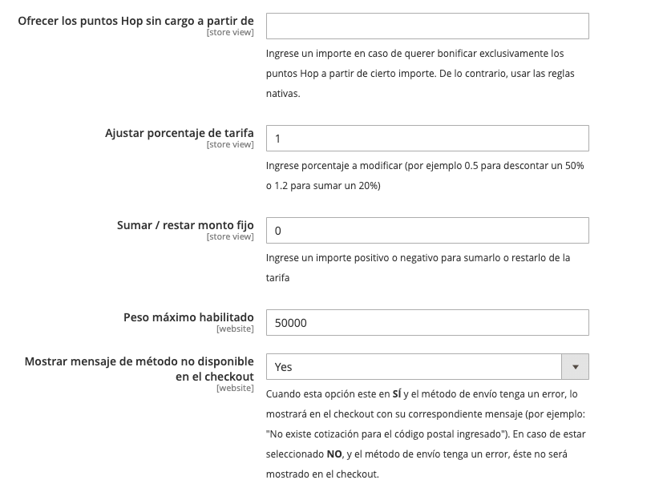

### 1.3 Peso máximo

**Peso máximo habilitado**, en **kilogramos** (por defecto, 100). Si el pedido pesa más,
Hop no se ofrece y el cliente ve: *"Su pedido supera el peso máximo permitido por Hop.
Por favor divida su orden en más pedidos o consulte al administrador de la tienda."*

### 1.4 Qué pasa cuando Hop no puede cotizar

**Mostrar mensaje de método no disponible en el checkout**:

- **Sí**: el método aparece con el motivo, por ejemplo *"No existen puntos de retiro para
  la dirección ingresada"* o *"No existen cotizaciones para la dirección ingresada"*.
- **No**: el método directamente no aparece.

**Sí** sirve mientras configurás, porque te dice qué falla. **No** es más prolijo para el
cliente en producción.

---

## 2. Configuración general

**Envíos Hop → Configuración.** Los campos de conexión están en la
[Guía de instalación](instalacion.md#3-configurar-la-conexión-con-hop). Acá van los que
afectan la operación.

### 2.1 Número de documento del cliente

Hop necesita el DNI del destinatario. **Utilizar "taxvat" como número de documento**
define de dónde sale:

- **Sí** (por defecto): se toma el campo *VAT Number* de la dirección de facturación.
  Para que el cliente lo pueda cargar en el checkout, activá también
  *Tiendas → Configuración → Clientes → Configuración de clientes → Opciones de creación
  de cuenta → Mostrar número de IVA en el frente de tienda (Show VAT Number on
  Storefront)* en **Sí**.

  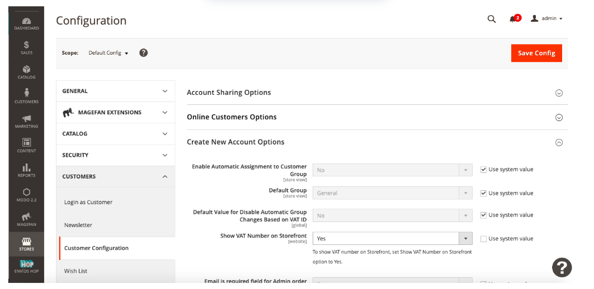
  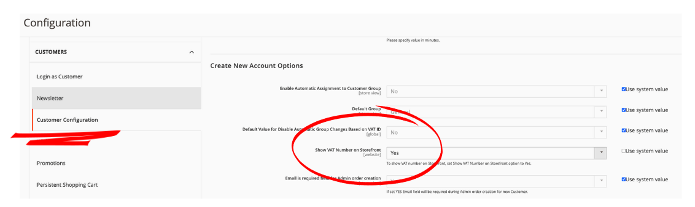

- **No**: aparece **Código del atributo para utilizar como dni**. Ahí va el nombre de una
  columna del pedido (tabla `sales_order`) que tenga el documento. **Requiere
  conocimientos técnicos**: si no sabés cuál es, pedíselo al equipo técnico.

  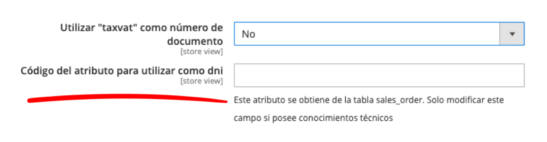

### 2.2 Despacho automático por estado

**Estados para generación etiqueta**: los estados del pedido que disparan el despacho a
Hop. Cuando un pedido pasa a uno de esos estados, el módulo crea el envío en Hop solo, en
el minuto siguiente, y la etiqueta queda lista para descargar.

Ejemplo: si elegís **Processing**, el pedido se despacha apenas se factura.

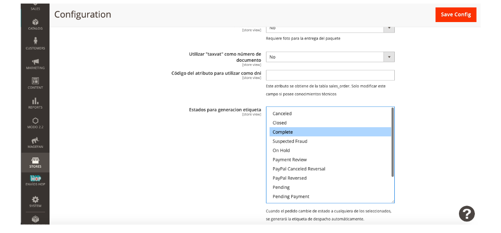

Si no elegís ningún estado, no hay despacho automático. Lo hacés a mano desde el pedido
con el botón **Enviar a HOP**.

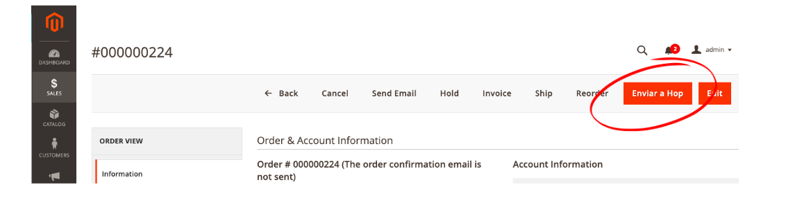

Las dos formas, y cómo se combinan con los envíos en varios bultos, están explicadas en
la [guía de multibulto](multibulto-guia-admin.md#2-las-cuatro-formas-de-despachar-un-pedido-a-hop).

### 2.3 Tamaño de categoría

Es el tamaño de **respaldo** para cotizar y despachar cuando los productos no tienen
medidas cargadas. Va del 1 al 13; la tabla de cada tamaño aparece debajo del campo:

| Tamaño | Alto × Profundidad × Ancho (cm) | Peso (kg) |
|---|---|---|
| 1 | 13 × 7 × 19,5 | hasta 0,5 |
| 2 | 20 × 11 × 30 | 0,5 a 1 |
| 3 | 25 × 16 × 35 | 1 a 2 |
| 4 | 80 × 80 × 80 | 2 a 5 |
| 5 | 90 × 90 × 90 | 5 a 10 |
| 6 | 100 × 100 × 100 | 10 a 15 |
| 7 | 110 × 110 × 110 | 15 a 20 |
| 8 | 120 × 120 × 120 | 20 a 25 |
| 9 | 130 × 130 × 130 | 25 a 30 |
| 10 | 140 × 140 × 140 | 30 a 35 |
| 11 | 150 × 150 × 150 | 35 a 40 |
| 12 | 160 × 160 × 160 | 40 a 45 |
| 13 | 170 × 170 × 170 | 45 a 165 |

Cómo arma el módulo el paquete:

- **Alto**: suma el alto de todos los productos (los apila).
- **Ancho y largo**: toma el mayor de todos los productos.
- Todas las medidas se multiplican por la cantidad de cada producto.
- Si el resultado no tiene las tres medidas (porque ningún producto las tiene cargadas),
  Hop usa el **tamaño de categoría** configurado.

Ejemplo: producto A de 10×10×10 y producto B sin medidas → el paquete es 10×10×10.
Productos C y D sin medidas → se usa el tamaño de categoría.

> Si dejás el tamaño de categoría vacío y los productos no tienen medidas, Hop puede no
> cotizar. Conviene configurarlo siempre.

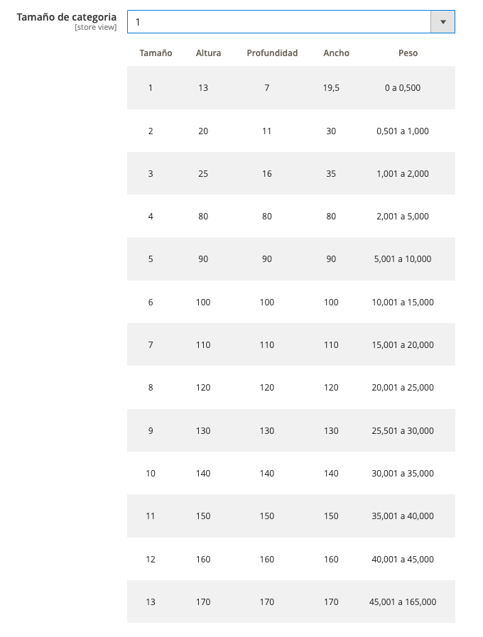

### 2.4 Atributos de medidas (alto, ancho y largo)

Al instalarse, el módulo crea tres atributos de producto: **Alto (cm)**, **Largo (cm)** y
**Ancho (cm)**. Son los que usa por defecto.

Si tu catálogo ya tiene sus propios atributos de medidas, no hace falta duplicarlos. En
**Atributo para Alto**, **Atributo para Largo** y **Atributo para Ancho** elegí los
atributos de la tienda, y guardá. Las medidas tienen que estar en **centímetros**.

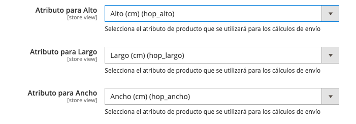

---

## 3. El checkout

Cuando el cliente carga su código postal:

- Ve el método Hop **con el precio ya cotizado**.
- Elige el punto de retiro en un **mapa** con los puntos cercanos, o en un **listado**.
- Si elige Hop pero no elige un punto, no puede avanzar: aparece un aviso para que lo
  seleccione.

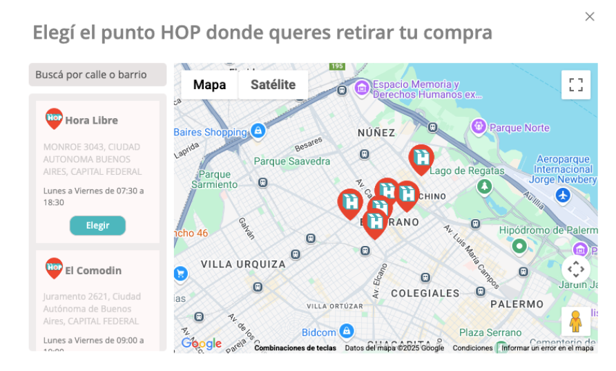
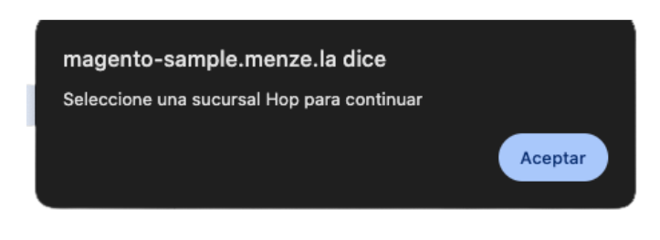

El punto elegido queda **asignado al pedido**.

---

## 4. Pedidos

### 4.1 Qué ves en el pedido

En la ficha del pedido, el bloque **Información Hop Envíos** muestra el punto
seleccionado actualmente y el que eligió el cliente en el checkout.

En la barra superior aparecen botones distintos según el momento:

| Momento | Botones |
|---|---|
| Antes de despachar | **Cambiar punto Hop** y **Enviar a HOP** |
| Despachado, un solo bulto | **Descargar etiqueta HOP** y **Estado HOP** |
| Despachado, varios bultos | **Etiquetas HOP** (un listado con la etiqueta y el estado de cada bulto) |

**Estado HOP** abre el seguimiento del envío en la web de Hop.

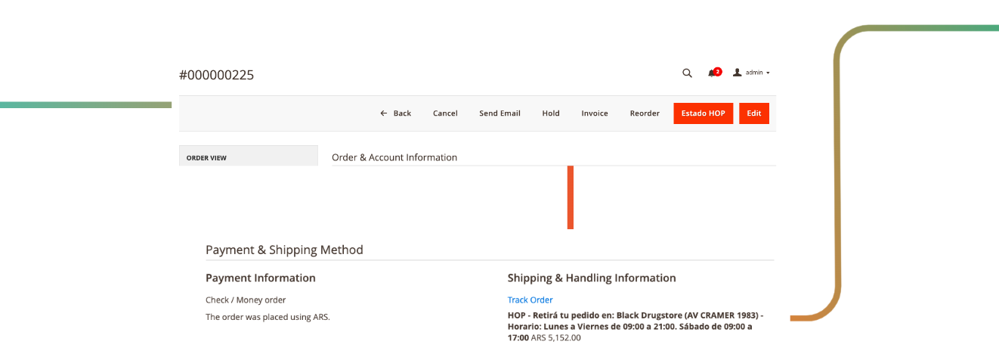

### 4.2 Cambiar el punto de retiro

Mientras el pedido **no fue despachado**, podés cambiar el punto con **Cambiar punto Hop**:
se abre un modal con los puntos disponibles para elegir otro. Sirve para corregir un error
o atender un pedido del cliente.

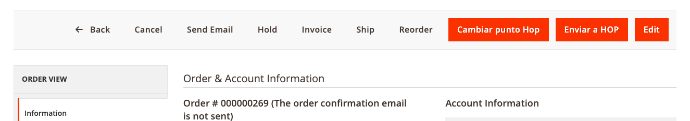

- Una vez que el pedido se despachó (con **Enviar a HOP** o en automático), el punto ya
  no se puede cambiar desde Magento.
- El cambio impacta directo en lo que se le manda a Hop al despachar.

> **Recomendación:** si el cliente pide cambiar el punto, hacelo antes de que el pedido
> pase a un estado de despacho automático.

### 4.3 Notificaciones al cliente

Hop le avisa al cliente por su cuenta las novedades del envío. Además, Magento le manda
su email de envío con el número de seguimiento.

---

## 5. Etiquetas

### 5.1 Formato y tamaño

Se definen en **Envíos Hop → Configuración**, no por pedido:

- **JPEG Default**: el módulo la convierte a **PDF** para descargarla.
- **ZPL2**: archivo para impresoras de etiquetas térmicas. Se abre directo.
- **Tamaño**: Pequeña (5,25×10 cm), Mediana (10×15 cm) o Grande (15×22,5 cm). Solo para
  JPEG.

### 5.2 Descarga individual

Desde el pedido, con **Descargar etiqueta HOP** (o **Etiquetas HOP** si son varios
bultos). También desde el envío: **Envíos → Ver → Información de envío y seguimiento →
Imprimir etiqueta de envío**.

Hop puede tardar hasta un minuto en publicar la etiqueta después del despacho. El módulo
la vuelve a pedir solo, cada minuto: si recién despachaste y todavía no está, esperá y
refrescá. Detalle en la [guía de multibulto](multibulto-guia-admin.md#4-las-etiquetas-y-el-minuto-de-espera).

### 5.3 Descarga masiva

En **Ventas → Pedidos**, seleccioná los pedidos y en **Acciones** elegí **Imprimir
etiquetas de envío** (*Print Shipping Labels*). Se descarga un PDF con todas.

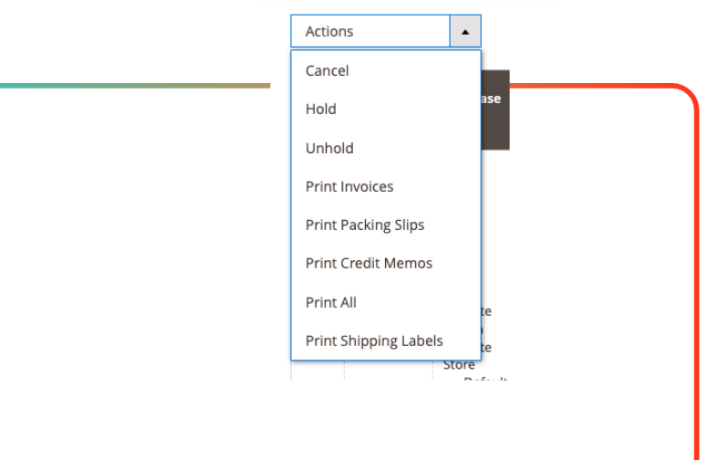

---

## 6. Estados del pedido según Hop

Hop puede avisarle a Magento cada novedad del envío (recibido, en distribución, listo
para retirar, entregado, devuelto…) para que el pedido cambie de estado solo. Cada aviso
queda además como comentario en el historial del pedido.

### 6.1 Generar las claves de integración

Hop necesita cuatro claves de tu tienda para poder avisarle a Magento.

1. Andá a **Sistema → Integraciones → Agregar nueva integración**.
2. En **Información de la integración** completá:
   - **Nombre**: `HOP Integration`.
   - **Email**: un correo técnico de contacto.
   - **Callback URL** e **Identity link URL**: vacíos.
   - **Tu contraseña**: la del usuario admin con el que estás logueado.

   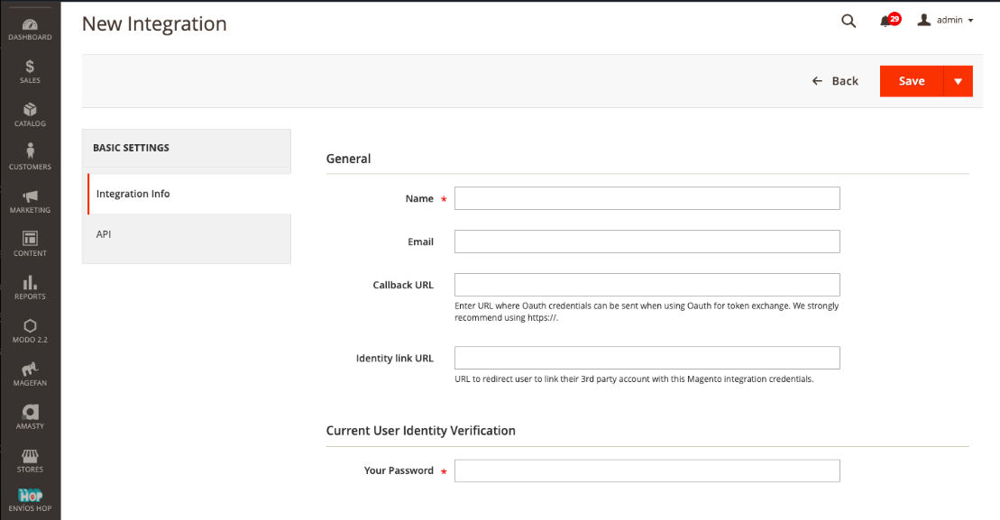

3. En la pestaña **API**, en **Acceso a recursos** elegí **Personalizado** y marcá:
   - **Hop Envios → Webhook Notifications** (es el que usa el módulo para recibir los
     avisos).
   - **Ventas → Operaciones → Pedidos**.
   - **Tiendas → Configuración**.

   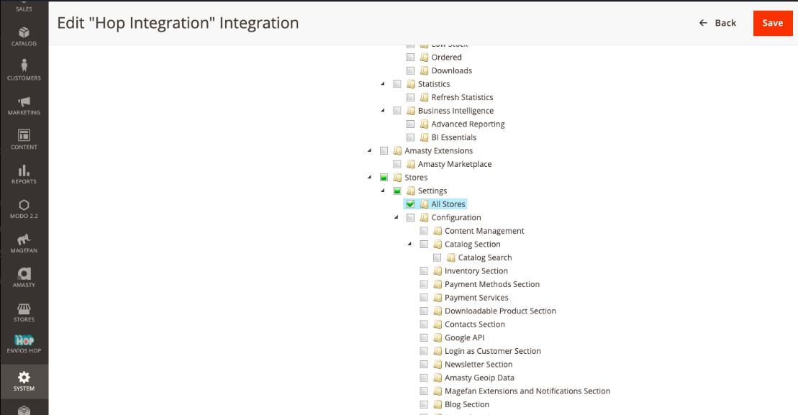
   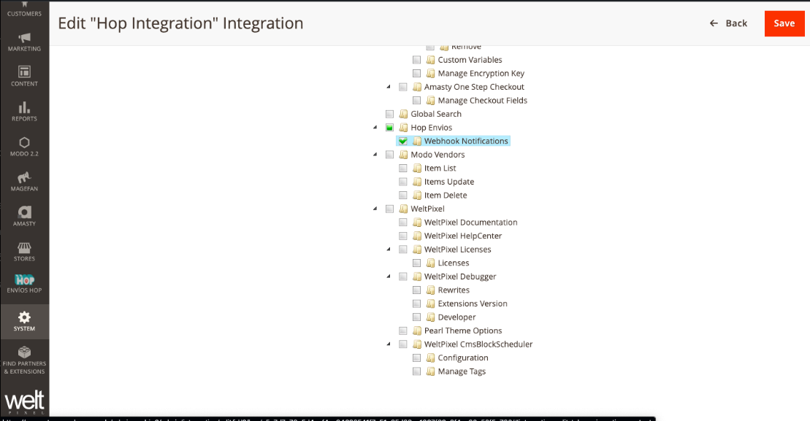

4. **Guardá** y después tocá **Activar**. Magento te vuelve a pedir la contraseña.
5. Se muestran las cuatro claves: **Consumer Key**, **Consumer Secret**, **Access Token**
   y **Access Token Secret**. Copialas y mandáselas al equipo técnico de Hop por un canal
   seguro.

### 6.2 Activar los cambios de estado

En **Envíos Hop → Métodos de envío → Manejo de estado de las ventas**:

1. Poné **Permitir que Hop notifique a Magento novedades y cambie el estado de las
   órdenes** en **Sí**.
2. Aparecen dos tablas, una para **Ventas en proceso** y otra para **Ventas completadas**.
   En cada una, elegí a qué estado de Magento pasa el pedido con cada novedad de Hop.
3. Guardá.

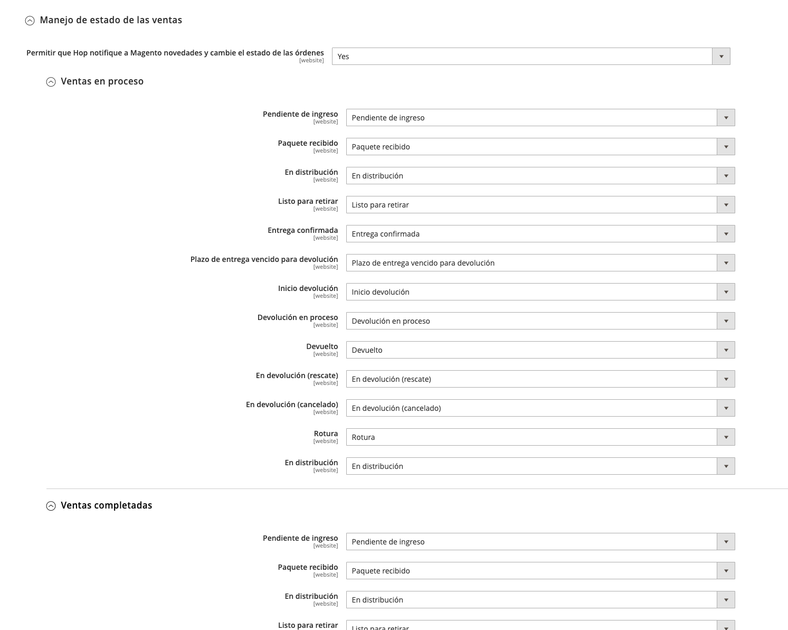

Cómo se aplica:

- La tabla que se usa depende de en qué etapa está el pedido: **en proceso** o
  **completado**. Cada tabla solo ofrece estados de esa etapa; el aviso cambia el estado,
  no la etapa.
- Ejemplo: Hop avisa **Listo para retirar** sobre un pedido en proceso → el pedido pasa al
  estado que elegiste para *Listo para retirar* en *Ventas en proceso*.

> **Importante:** sin este paso los avisos de Hop se rechazan, aunque Hop ya tenga las
> claves.

---

## 7. Problemas frecuentes

| Qué pasa | Qué revisar |
|---|---|
| Hop no aparece en el checkout | Que esté **Habilitado**, que las credenciales sean del modo correcto (productivo o sandbox) y que haya puntos para ese código postal. Poné *Mostrar mensaje de método no disponible* en **Sí** para ver el motivo. |
| "Supera el peso máximo permitido" | El **Peso máximo habilitado** (en kg) y el peso cargado en los productos. |
| Hop cotiza un precio raro | Las medidas de los productos y el **Tamaño de categoría**. Recordá que el alto se suma y que todo se multiplica por la cantidad. |
| El mapa del checkout no carga | La **Api Key Google Maps**. |
| No aparece **Enviar a HOP** | El pedido no tiene punto asignado o ya fue despachado. Ver la [guía de multibulto](multibulto-guia-admin.md#el-botón-enviar-a-hop-no-aparece). |
| El pedido no se despachó solo | Que su estado esté en **Estados para generación etiqueta** y que el cron de Magento esté corriendo. |
| El pedido no cambia de estado con los avisos de Hop | Que esté activado el **Manejo de estado de las ventas** (6.2) y que Hop tenga las claves (6.1). |
| Hop no tiene el DNI del cliente | La opción de **número de documento** (2.1). |
