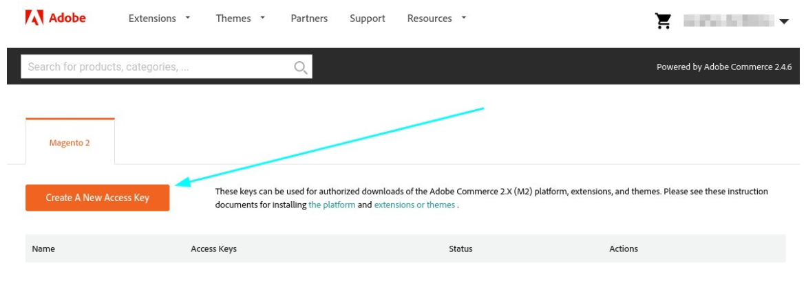
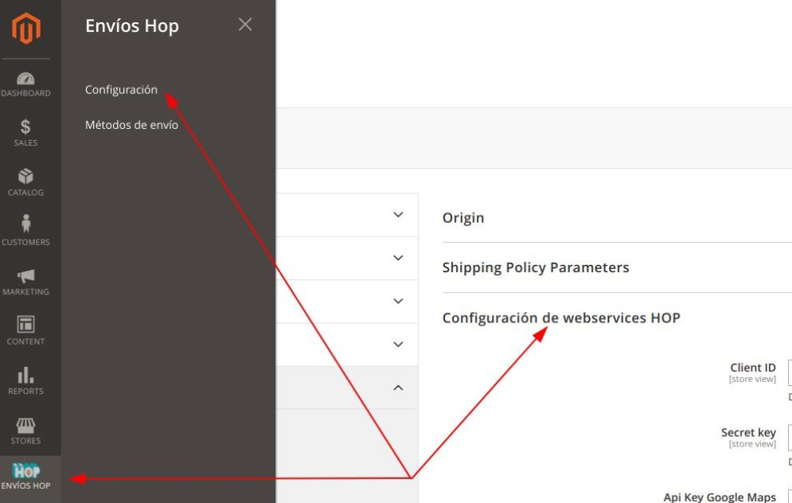
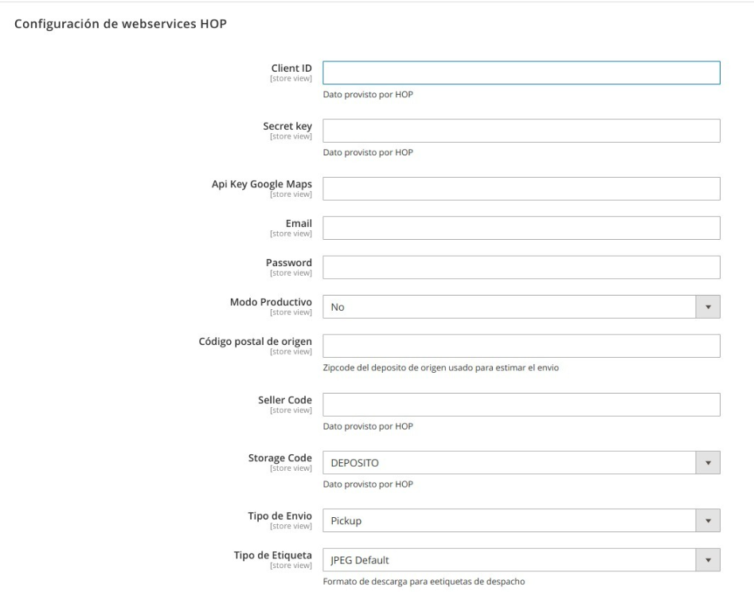
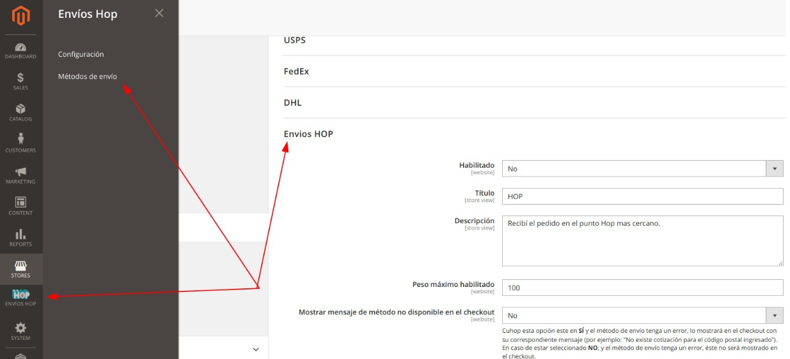

# Instalación y configuración inicial del módulo Hop Envíos

Guía para quien instala el módulo **Hop Envíos** en una tienda Magento 2 y lo deja listo
para cotizar. Cubre la instalación por consola, la configuración de conexión con Hop y
la habilitación del método de envío.

Una vez instalado, la operación diaria (métodos de envío, etiquetas, pedidos, estados)
está en la [Guía de uso](guia-usuario.md).

---

## 1. Antes de empezar

Necesitás:

- **Magento 2** instalado y acceso a la consola del servidor (`bin/magento`).
- **Composer**, y una cuenta en [Magento Marketplace](https://commercemarketplace.adobe.com/)
  para generar las claves de descarga.
- **Credenciales de Hop**: Client ID, Secret key, Email, Password y Seller Code. Las
  provee Hop; pedilas a [Hop Envíos](https://www.hopenvios.com.ar/). Hay credenciales
  distintas para pruebas (sandbox) y para producción.
- **Una API key de Google Maps**, que corre por cuenta de la tienda. Se usa para el
  mapa de puntos de retiro en el checkout.
- **El cron de Magento funcionando.** El módulo lo usa para actualizar los puntos de
  retiro, despachar pedidos automáticamente y descargar las etiquetas
  (ver [Anexo A](#anexo-a--tareas-programadas-cron)).

---

## 2. Instalación por consola

### 2.1 Descargar el módulo

```bash
composer require hopenvios/magento2
```

Si Composer te pide usuario y contraseña, usá las claves de acceso de tu cuenta de
Magento Marketplace: la **Public Key** es el usuario y la **Private Key** es la
contraseña. Se generan desde *My Profile → Access Keys → Create A New Access Key*.



### 2.2 Habilitar el módulo — producción

```bash
php bin/magento deploy:mode:set production
php bin/magento module:enable Hop_Envios
php bin/magento setup:upgrade
php bin/magento setup:di:compile
php bin/magento setup:static-content:deploy es_AR en_US
```

Ajustá la lista de idiomas de `setup:static-content:deploy` a los que use la tienda.

### 2.3 Habilitar el módulo — desarrollo o pruebas

Para un ambiente de pruebas alcanza con el modo developer, que no necesita compilar:

```bash
php bin/magento deploy:mode:set developer
php bin/magento module:enable Hop_Envios
php bin/magento setup:upgrade
php bin/magento setup:static-content:deploy -f
```

### 2.4 Permisos de archivos

Después de instalar, dejá los permisos de `pub/`, `var/` y `generated/` como los use el
resto de la instalación de Magento. No hace falta `777`.

### 2.5 Qué crea la instalación

- El menú **Envíos Hop** en la barra lateral del admin.
- Tres atributos de producto para las medidas: **Alto (cm)**, **Largo (cm)** y
  **Ancho (cm)** (`hop_alto`, `hop_largo`, `hop_ancho`). Se usan para cotizar; podés
  reemplazarlos por atributos propios (ver la [Guía de uso](guia-usuario.md#24-atributos-de-medidas-alto-ancho-y-largo)).

---

## 3. Configurar la conexión con Hop

Entrá a **Envíos Hop → Configuración**. Te lleva a *Tiendas → Configuración → Ventas →
Configuración de envío → Configuración de webservices HOP*.



Completá los campos:

| Campo | Qué poner |
|---|---|
| **Client ID** | Provisto por Hop. |
| **Secret key** | Provisto por Hop. |
| **Api Key Google Maps** | La key de Google Maps de la tienda. Sin ella el mapa del checkout no carga. |
| **Email** / **Password** | Provistos por Hop. |
| **Modo Productivo** | **Sí** para producción. **No** usa el sandbox de Hop, con sus credenciales de prueba. |
| **Versión de API para Puntos Hop** | La que indique Hop. Por defecto, **V1**. |
| **Código postal de origen** | El código postal del depósito desde donde sale la mercadería. Se usa para cotizar. |
| **Seller Code** | Provisto por Hop. |
| **Storage Code** | **DEPOSITO** u **OFICINA**, según lo que indique Hop. |
| **Tipo de Envío** | **Pickup**, **Drop-off** o **Pickup/Drop-off**, según el servicio contratado. |
| **Tipo de Etiqueta** | **JPEG Default** (se descarga como PDF) o **ZPL2** (para impresoras de etiquetas). |
| **Tamaño de Etiqueta** | Pequeña (5,25×10 cm), Mediana (10×15 cm) o Grande (15×22,5 cm). No aplica a ZPL2. |
| **Días de preparación** | Días que la tienda tarda en preparar el paquete. `0` si se despacha en el día. |
| **Tamaño de categoría** | Tamaño de respaldo para cotizar cuando los productos no tienen medidas. Ver la [Guía de uso](guia-usuario.md#23-tamaño-de-categoría). |
| **Atributo para Alto / Largo / Ancho** | Los atributos de producto con las medidas. Por defecto, los que crea el módulo. |
| **Validar cliente** | **Sí** si Hop debe validar la identidad del destinatario al entregar. |
| **Utilizar "taxvat" como número de documento** | De dónde sale el DNI del cliente. Ver la [Guía de uso](guia-usuario.md#21-número-de-documento-del-cliente). |
| **Estados para generación etiqueta** | Estados del pedido que disparan el despacho automático a Hop. Ver la [Guía de uso](guia-usuario.md#22-despacho-automático-por-estado). |



Guardá la configuración.

> Si la tienda vende a **Perú**, hay una sección adicional para el Ubigeo. Está en
> [Configuración para Perú](peru-ubigeo.md).

---

## 4. Habilitar el método de envío

Entrá a **Envíos Hop → Métodos de envío** y poné **Habilitado** en **Sí**. Guardá.



Con eso el método Hop ya aparece en el checkout para los códigos postales con puntos de
retiro disponibles. El resto de las opciones del método (título, precios, peso máximo)
están en la [Guía de uso](guia-usuario.md#1-método-de-envío).

---

## 5. Comprobar que quedó funcionando

1. En el front, agregá un producto al carrito y andá al checkout.
2. Cargá un código postal con cobertura de Hop.
3. Tiene que aparecer el método **Hop** con precio, y el mapa o listado de puntos de
   retiro.

Si no aparece:

- Revisá que el método esté **Habilitado** y que las credenciales correspondan al modo
  elegido (productivo o sandbox).
- Poné **Mostrar mensaje de método no disponible en el checkout** en **Sí** (en
  *Métodos de envío*). Así, en vez de ocultarse, el método muestra el motivo, por ejemplo
  *"No existen puntos de retiro para la dirección ingresada"*.
- Revisá los logs del módulo en el servidor: `var/log/hopMM_AAAA.log` y
  `var/log/error_hop_MM_AAAA.log`.

---

## Anexo A — Tareas programadas (cron)

El módulo registra tres tareas en el cron de Magento. Si el cron no corre, ninguna de
estas cosas pasa:

| Tarea | Frecuencia | Qué hace |
|---|---|---|
| `hop_envios_load_points` | cada hora | Actualiza la lista de puntos de retiro de Hop. |
| `hop_envios_genarate_shipment` | cada minuto | Despacha a Hop los pedidos que pasaron a un estado de *Estados para generación etiqueta*. |
| `hop_envios_generate_shipping_labels` | cada minuto | Descarga las etiquetas que Hop todavía no tenía listas al momento del despacho. |
